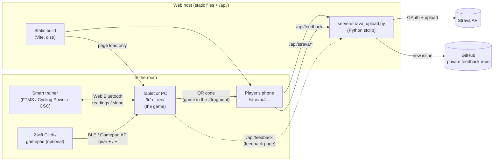
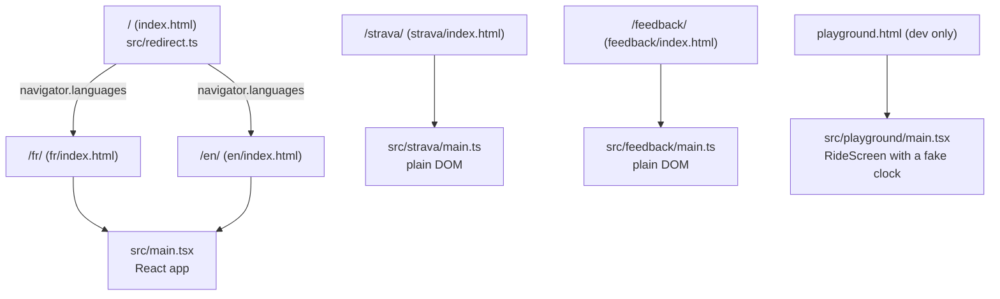
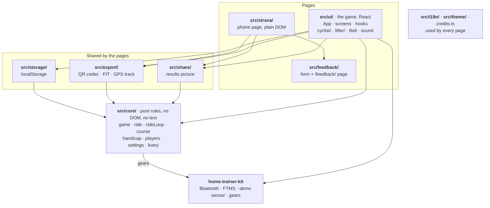
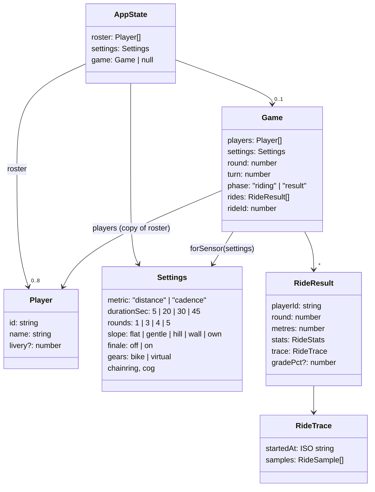
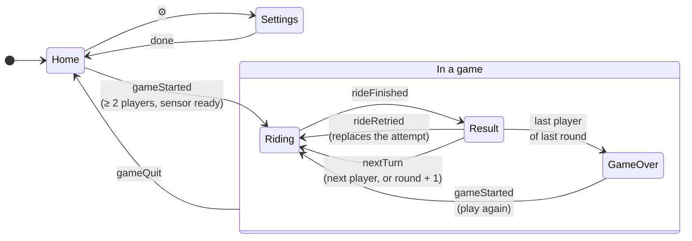
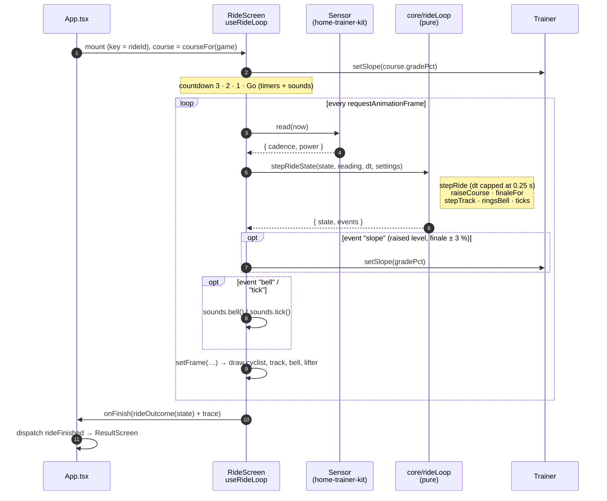
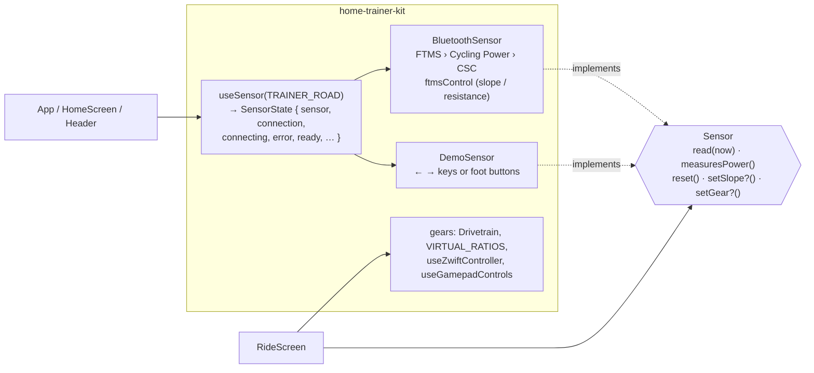
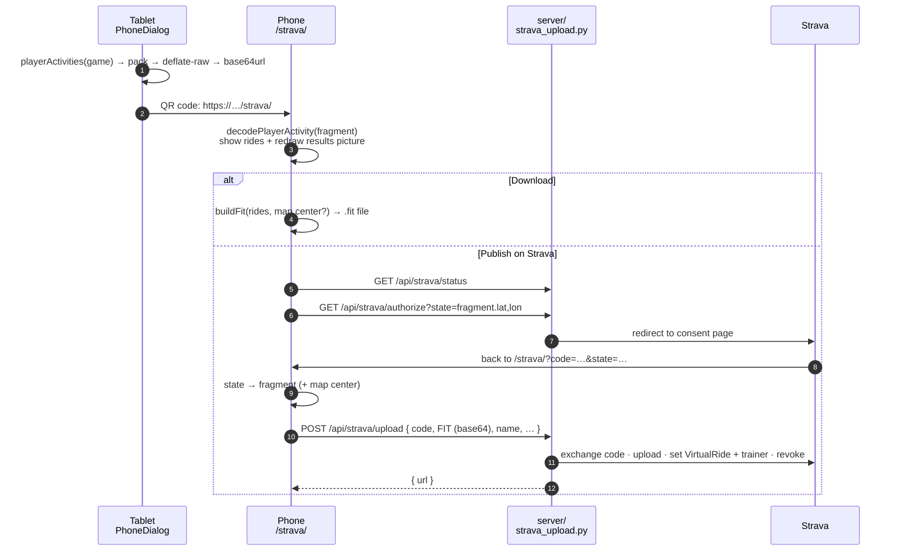
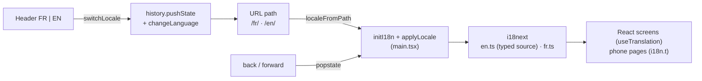
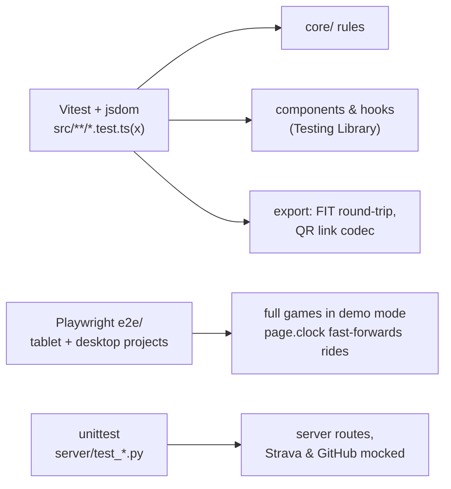

# Architecture

How the code of _Sonne la cloche !_ is laid out and how the pieces talk to
each other. The diagrams are [Mermaid](https://mermaid.js.org/): GitHub and
VS Code (with a Mermaid extension) render them.

For the scoring model itself (virtual slopes, handicap), see
[handicap.md](handicap.md). For the rules every change must respect (audience,
one screen, fast path), see [CLAUDE.md](../CLAUDE.md).

## The big picture

One tablet or PC runs the game, talks to the trainer over Web Bluetooth and
needs nothing else while playing. After the game, each player can scan a QR
code: their rides travel _inside the URL_ to their phone, which can download
a FIT file or publish on Strava through a tiny optional server.

Key points:

- **No network during a game.** Fonts are bundled, nothing is fetched after
  page load. The server is optional: without it the phone page still offers
  the FIT download, and the feedback form hides itself.
- **The phone gets its data from the QR code**, in the URL fragment (`#…`),
  which browsers never send to a server. Nothing about a game is stored
  anywhere but on the tablet.
- **The server stores nothing**: it holds the Strava client secret, uses each
  access token for a single upload and revokes it.

## Pages (build entry points)

The build is a multi-page app (`appType: "mpa"` in
[vite.config.ts](../vite.config.ts)): one static HTML file per page, so any
static host works without rewrite rules.

| Page           | Code                      | Role                                                                        |
| -------------- | ------------------------- | --------------------------------------------------------------------------- |
| `/`            | `src/redirect.ts`         | Picks a language from the browser and redirects (keeps `?…` and `#…`).      |
| `/fr/`, `/en/` | `src/main.tsx` → `App`    | The game. Same bundle, language read from the path.                         |
| `/strava/`     | `src/strava/main.ts`      | The phone page a QR code opens: rides, results picture, FIT, Strava.        |
| `/feedback/`   | `src/feedback/main.ts`    | The "Your opinion?" form, reached from the game.                            |
| `playground`   | `src/playground/main.tsx` | Local tool to tune the ride screen (speed up time, fake sensor). Not built. |

The phone and feedback pages are plain DOM on purpose: they load fast on a
phone and need no React.

## Layers

One arrow per real import between folders. Everything points down: nothing
imports the React app, and `core/` imports only from the kit. `i18n/` and
`theme/` are used by all three pages and left out of the arrows.

Rules the arrows follow:

- **`core/` is pure**: no React, no DOM, no text. It returns data (numbers,
  enums, error codes); only `ui/` and the phone pages turn it into words
  through i18n. Its only import from outside is a type and the default
  drivetrain from `home-trainer-kit/gears`. Inside it there is no import
  cycle: `handicap.ts` is the physics, `course.ts` picks each player's course
  from the game, `rideLoop.ts` runs a ride frame by frame.
- **Game rules live in `core/` with unit tests**, never in components.
- **What is shared lives outside `ui/`**: the results picture (`share/`), the
  theme and the plain pages' layout (`theme/`), the credits. The phone and
  feedback pages never import the React app.
- **`storage/` never throws**: storage may be missing or full (private
  browsing) and the game must still work. Everything read back goes through
  `parseRoster` / `parseSettings`, which treat it as untrusted.
- **`home-trainer-kit`** owns everything about the hardware (Web Bluetooth,
  FTMS/CP/CSC parsing, slope control, demo sensor, virtual gears, Zwift
  remote). It is shared with _contour_ and pinned to a git tag in
  `package.json`.

## Application state

All game state is one reducer, [src/core/game.ts](../src/core/game.ts).
`App.tsx` holds it with `useReducer` and picks the screen from it; the
screens derive everything else through selectors (`standings`, `bestRide`,
`lastRide`, `highlights`, `upNext`, `summarize`).

- `game.players` and `game.settings` are **copies taken at start**: the
  roster and settings can't change mid-game (the reducer ignores those
  actions while a game exists), and `forSensor` switches a game to pedal
  turns when the bike measures no power, without touching the saved settings.
- `rideId` changes on every ride attempt; `App` uses it as the `key` of
  `RideScreen`, so each ride starts from a fresh component.
- `roster` and `settings` are saved to `localStorage` by two `useEffect`s in
  `App`. Stored settings carry a `version`; `migrateSettings` brings old ones
  up to date.

### Game flow

`Home` and `Settings` are `game === null` (with a local `settingsOpen` flag
in `App`); `GameOver` is `phase === "result"` with `isGameOver(game)` true.
While a game exists, `useHistoryGuard` keeps the back button on the page and
`useLeaveWarning` asks before closing it: leaving would drop the Bluetooth
connection.

## The ride loop

A ride is the hot path. `RideScreen` runs a countdown (3, 2, 1, Go), then
`useRideLoop` polls the sensor **once per animation frame** and hands each
reading to `stepRideState` ([src/core/rideLoop.ts](../src/core/rideLoop.ts)).
That pure function makes every decision (score, raised slope, finale, bell,
ticks) and returns the new state with **events**; the hook only carries them
out (trainer, sounds) and draws the frame.

- The sensor is read **through a ref**: reconnecting the bike mid-ride must
  not restart the ride.
- One `RideSample` is recorded per whole second (cadence, power, speed,
  slope); that trace is what the FIT export and the QR link carry.
- **Scoring** (`stepRide`): by _distance_, measured power drives a virtual
  bike on the course's slope (`stepSpeed`, a physics model shared with the
  trainer's road settings, `TRAINER_ROAD`); by _leg speed_, cadence drives it
  at 4 m per crank turn. Either way the score is metres.
- **Own slopes** (`courseFor` / `courseOf` in `core/course.ts`): round 1 is on the common slope
  and measures everyone; from round 2 each player gets the slope on which
  their reference power holds the weakest player's speed. See
  [handicap.md](handicap.md).
- Out of a ride, `App` keeps the trainer on the common slope.

## Hardware: home-trainer-kit

The game only sees the `Sensor` interface. Bluetooth and the demo sensor are
interchangeable, which is what makes the demo mode (and the e2e tests)
possible.

- `useMeasuresPower` watches the sensor on the home screen; at "Let's go",
  `measuresPower()` decides whether the game scores distance or pedal turns.
- With `gears: "virtual"` (a Zwift Cog), `useVirtualGear` shifts through
  `setGear` from the Zwift Click or any gamepad.
- `useWakeLock` keeps the screen on while a sensor is connected.

## After the game: phone, FIT and Strava

- **The OAuth `state` carries the game itself** through Strava's consent
  page, so the upload can finish in whichever tab or app Strava returns to.
- **The link must stay small** (it is a QR code): `playerLink.ts` packs each
  second into a few bytes (power in 4 W steps, speed as deltas), then
  compresses. Its format has a version byte; older links keep being read.
- **FIT** (`export/fit.ts`, with `@markw65/fit-file-writer`): with the
  player's consent the phone's position becomes the centre of a virtual
  30 m circular track (`virtualTrack.ts`), so the activity gets a map and
  Strava counts real moving time.
- The Strava part only appears after a game on a real bike (`strava: false`
  in demo mode), except with `?dev`.

## Server

[server/strava_upload.py](../server/strava_upload.py), standard library only
(`ThreadingHTTPServer`, `urllib`), listening on `127.0.0.1:8787` behind the
web server's `/api/` proxy. Configuration comes from the environment.

| Route                       | Does                                                                  |
| --------------------------- | --------------------------------------------------------------------- |
| `GET /api/strava/status`    | `{configured}`: whether to show "Publish on Strava".                  |
| `GET /api/strava/authorize` | Redirects to Strava's consent page (mobile or web).                   |
| `POST /api/strava/upload`   | Code → token, upload FIT, set type/title/trainer, revoke.             |
| `GET /api/feedback/status`  | `{configured}`: whether to show the feedback form.                    |
| `POST /api/feedback`        | Files the message as an issue ([feedback.py](../server/feedback.py)). |

## Internationalisation

The language lives in the URL so a link or bookmark carries it, and switching
**never reloads the page** (that would drop the Bluetooth connection). ESLint
(`i18next/no-literal-string`) rejects literal text in JSX, and a unit test
checks that `en.ts` and `fr.ts` have the same keys and placeholders.

## Tests

`pnpm check` runs them all after Prettier, ESLint and `tsc`. CI
([.github/workflows/ci.yml](../.github/workflows/ci.yml)) runs the same three
suites and sends coverage to Codecov. The demo sensor is the only way to
test without the bike: never break it.

## Where to look

| To change…                             | Go to                                                        |
| -------------------------------------- | ------------------------------------------------------------ |
| a game rule, turn order, ranking       | `src/core/game.ts` (+ `game.test.ts`)                        |
| scoring during a ride, the bell, track | `src/core/ride.ts`, `src/core/rideLoop.ts`                   |
| slopes, handicap, physics              | `src/core/handicap.ts`, `course.ts`, `docs/handicap.md`      |
| a setting or its default               | `src/core/settings.ts`, `src/storage/storage.ts` (migration) |
| what the ride screen shows             | `src/ui/RideScreen.tsx`, `cyclist/`, `lifter/`               |
| a text                                 | `src/i18n/en.ts` and `src/i18n/fr.ts`                        |
| colours, fonts                         | tokens at the top of `src/theme/theme.css`                   |
| what the QR code carries               | `src/export/playerLink.ts`                                   |
| the Strava activity                    | `src/export/fit.ts`, `activityText.ts`, `server/`            |
| the results picture                    | `src/share/resultCard.ts`                                    |
| Bluetooth, trainer control, gears      | `home-trainer-kit` (fix there, tag, bump here)               |
